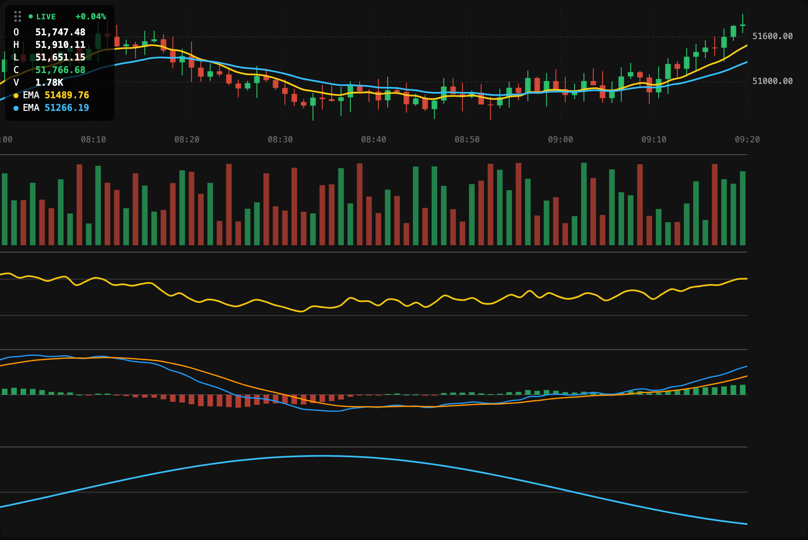

# `@stacklatte/chart-angular`

A trading chart for Angular: one standalone `<sl-chart>` component with candlesticks, SMA/EMA/Bollinger overlays, RSI + MACD + volume panels, trade markers, pan / pinch / wheel zoom, crosshair inspection and live-streaming updates. Canvas 2D — no WebAssembly, no extra runtime.



- **Standalone, signal- and zoneless-friendly.** Import the component, bind inputs. Repaints run outside the Angular zone, so a ticking feed doesn't trigger change detection per frame.
- **SSR-safe.** Renders nothing on the server and attaches in the browser after first render.
- **Real indicator math.** Wilder-smoothed RSI, correctly seeded MACD (12/26/9), O(n) Bollinger Bands — the same tested engine that powers the React and React Native charts.
- **LLM-safe config.** `buildChartPipeline()` (re-exported) turns a validated, closed-enum `ChartConfig` into component inputs; a JSON Schema ships in `@stacklatte/chart-engine`. See [`llms.txt`](./llms.txt).

```sh
npm install @stacklatte/chart-angular
```

```ts
import { Component } from '@angular/core';
import { SlChartComponent, calcSMA } from '@stacklatte/chart-angular';
import type { Candle } from '@stacklatte/chart-angular';

@Component({
  selector: 'app-chart',
  standalone: true,
  imports: [SlChartComponent],
  template: `
    <sl-chart
      [data]="candles"
      [width]="900" [height]="520"
      theme="dark"
      [showVolumePanel]="true" [showRsiPanel]="true"
      [showOhlcHud]="true"
      (crosshairChange)="selected = $event" />
  `,
})
export class ChartPage {
  candles: Candle[] = /* { timestamp, open, high, low, close, volume }[] */ [];
  selected: Candle | null = null;
}
```

## Inputs

| Input | Type | Default |
|---|---|---|
| `data` *(required)* | `Candle[]` | — |
| `width`, `height` *(required)* | `number` (px) | — |
| `theme` | `'dark' \| 'light' \| ChartThemeColors` | `'dark'` |
| `chartType` | `'candle' \| 'line'` | `'candle'` |
| `indicators` / `shadedAreas` / `markers` / `customPanels` | engine types | — |
| `showRsiPanel`, `showMacdPanel`, `showVolumePanel` | `boolean` | `false` |
| `rsiPeriod` | `number` | `14` |
| `showOhlcHud` | `boolean` (the full OHLC + indicator HUD, draggable, plus the crosshair — identical to React / React Native) | `false` |
| `visibleDataPoints` | `number` | `60` |
| `intervalMs`, `hour12`, `showGrid`, `maxZoom` | see the [chart-react README](../chart-react/README.md) | — |
| `scrollToLatestTrigger` | `number` — increment to jump to the latest candle | — |

| Output | Payload |
|---|---|
| `crosshairChange` | the inspected `Candle`, or `null` when released |

Props are identical to the React `SLChart`, so documentation for [`@stacklatte/chart-react`](../chart-react) applies 1:1.

## How it's built

`<sl-chart>` is a thin wrapper over `ChartController` from `@stacklatte/chart-engine/canvas` — the same Canvas 2D drawing code the React renderer uses — so both web renderers draw identically.

Every `ChartProps` feature is supported, including the hover tooltip for trade markers.

Supports Angular 19+. MIT licensed.

## Guides, demos and tests

- **Guide:** [Angular guide](../docs/angular.md) · [all docs](../docs/README.md) · [API reference](../docs/api-reference.md) · [for LLMs: `llms.txt`](./llms.txt)
- **Runnable demo:** `npm run demo:angular` — serves 37 scenarios (feature, edge, stress, live) at `/#/scenarios/<id>`
- **Measured:** 60 fps (p95 frame ≈ 17–18 ms) with 50,000 candles; the wrapper itself is under 2 kB gzipped.
- **Tested like people depend on it:** the same scenario catalogue runs on every platform, with performance budgets and a compatibility oracle against the published packages — see [Testing](../docs/testing.md).
