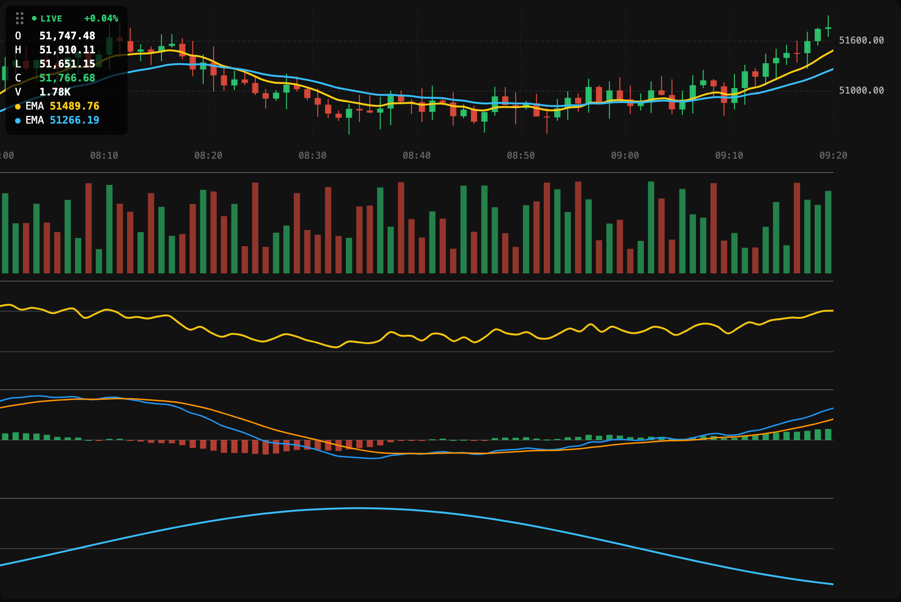

# Angular (`@stacklatte/chart-angular`)

A standalone `<sl-chart>` component for Angular 19+. Canvas 2D, server-side-rendering safe (it draws only in the browser), zoneless-friendly (repaints run outside the Angular zone, so a ticking feed does not trigger change detection per frame).

<!-- screenshots -->


<sub>`<sl-chart>` with the Volume, RSI and MACD panels on. Screenshot of the Angular demo, scenario `all-panels`. More: <a href="images/angular-markers.png">trade markers</a>, <a href="images/angular-hud-crosshair.png">HUD + crosshair</a>, <a href="images/angular-bollinger.png">Bollinger Bands</a>.</sub>
<!-- /screenshots -->


```sh
npm install @stacklatte/chart-angular
```

## Minimal chart

```ts
import { ChangeDetectionStrategy, Component, input } from '@angular/core';
import { SlChartComponent } from '@stacklatte/chart-angular';
import type { Candle } from '@stacklatte/chart-angular';

@Component({
  selector: 'app-price-chart',
  standalone: true,
  imports: [SlChartComponent],
  changeDetection: ChangeDetectionStrategy.OnPush,
  template: `<sl-chart [data]="candles()" [width]="800" [height]="420" theme="dark" />`,
})
export class PriceChartComponent {
  readonly candles = input.required<Candle[]>();
}
```

## Panels, HUD and the crosshair output

```ts
import { Component, signal } from '@angular/core';
import { SlChartComponent } from '@stacklatte/chart-angular';
import type { Candle } from '@stacklatte/chart-angular';

@Component({
  selector: 'app-analysis',
  standalone: true,
  imports: [SlChartComponent],
  template: `
    <sl-chart
      [data]="candles"
      [width]="900"
      [height]="560"
      [showVolumePanel]="true"
      [showRsiPanel]="true"
      [showMacdPanel]="true"
      [showOhlcHud]="true"
      (crosshairChange)="selected.set($event)" />
    <p>{{ selected()?.close ?? 'hover the chart' }}</p>
  `,
})
export class AnalysisComponent {
  candles: Candle[] = [];
  readonly selected = signal<Candle | null>(null);
}
```

`(crosshairChange)` emits the inspected candle, or `null` when the pointer leaves. `[showOhlcHud]="true"` turns on the crosshair and the **full OHLC + indicator HUD** — the same one React and React Native show: LIVE (or the inspected candle's time), the % change, O/H/L/C and volume, the RSI while inspecting, one row per entry in `[indicators]` and one per custom-panel series. Drag its grip to move it out of the way.

## Inputs

`data`, `width`, `height` (required) plus `theme`, `chartType`, `indicators`, `shadedAreas`, `markers`, `customPanels`, `intervalMs`, `visibleDataPoints`, `showOhlcHud`, `showRsiPanel`, `rsiPeriod`, `showMacdPanel`, `showVolumePanel`, `showGrid`, `hour12`, `maxZoom` and `scrollToLatestTrigger` — the same meanings as in the [API reference](./api-reference.md) (`ChartProps`). Output: `crosshairChange`.

## Server-side rendering

On the server the component renders only its container; the canvas is created in the browser after the first render. There is nothing to configure.

## Trade markers

Pass `[markers]` and hovering (mouse) or touching (touch) a marker shows a tooltip with its label, price, time and — if you set `changePct` — the signed change. Markers and indicator series may be supplied in any order; they are sorted rather than dropped. Everything in `ChartProps` is supported.

## How it is tested

`<sl-chart>` runs the full scenario catalogue in Chromium via Playwright against a real Angular app built from the package's `dist/` output, plus component tests through Angular's `TestBed` — see [Testing](./testing.md).
