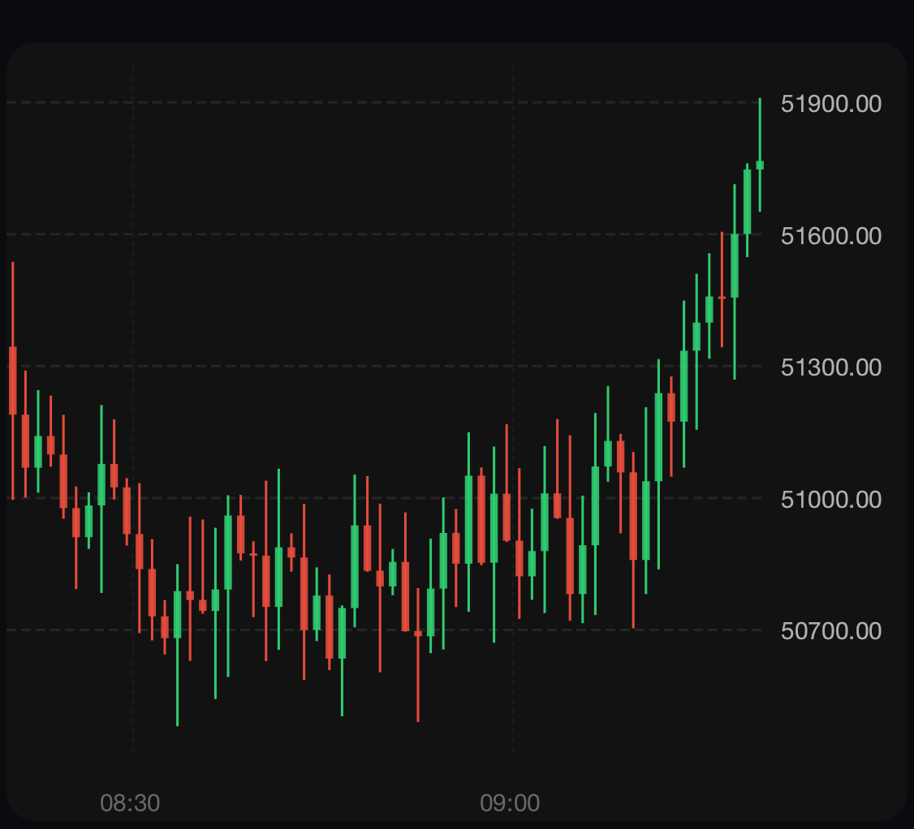
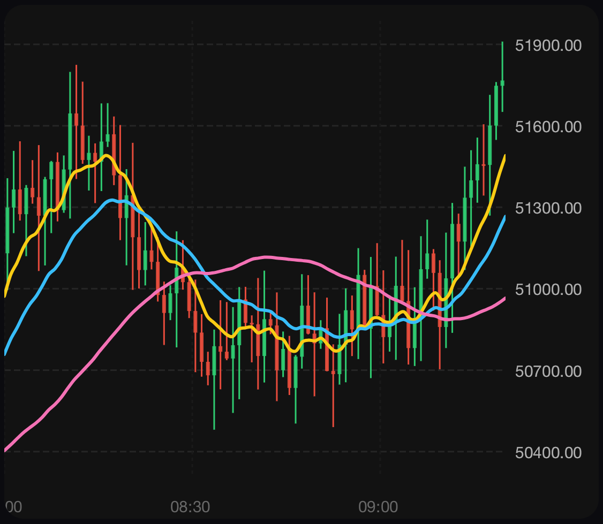
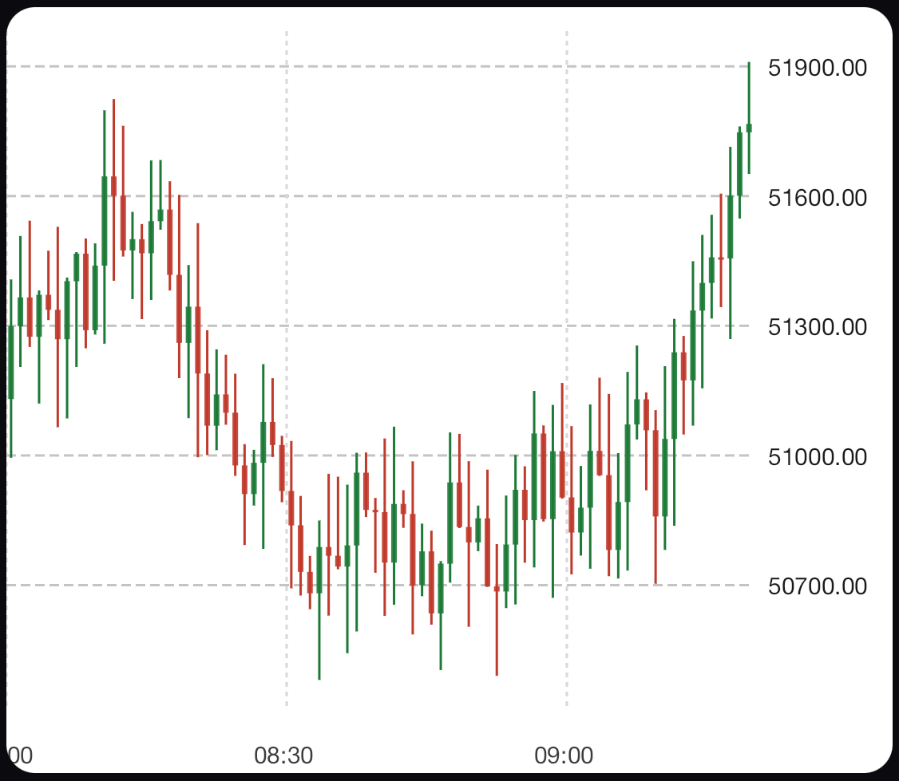

# React Native (`@stacklatte/chart-native`)

GPU-accelerated with [React Native Skia](https://shopify.github.io/react-native-skia/). iOS and Android, Expo or bare. Props are identical to the web `SLChart`.

<!-- screenshots -->
| Candles | Indicators | Light theme |
|---|---|---|
|  |  |  |

<sub>Screenshots from the iOS simulator running the native demo (scenarios `basic`, `indicators`, `theme-light`).</sub>
<!-- /screenshots -->


```sh
npm install @stacklatte/chart-native @shopify/react-native-skia react-native-gesture-handler
```

Peers: `react` 19+, `react-native` 0.79+, `@shopify/react-native-skia` 2+, `react-native-gesture-handler` 2+/3+.

## Setup: wrap the app in `GestureHandlerRootView`

Pan and pinch use `react-native-gesture-handler`, so the root of your app needs its provider (Expo Router: `app/_layout.tsx`):

```tsx
import { GestureHandlerRootView } from 'react-native-gesture-handler';
import { Slot } from 'expo-router';

export default function RootLayout() {
  return (
    <GestureHandlerRootView style={{ flex: 1 }}>
      <Slot />
    </GestureHandlerRootView>
  );
}
```

## Minimal chart

```tsx
import { SLChart } from '@stacklatte/chart-native';
import type { Candle } from '@stacklatte/chart-native';
import { useWindowDimensions } from 'react-native';

export function PriceChart({ candles }: { candles: Candle[] }) {
  const { width } = useWindowDimensions();
  return <SLChart data={candles} width={width} height={420} theme="dark" showRsiPanel showOhlcHud />;
}
```

`width` and `height` are numbers (density-independent pixels). Pan with one finger, pinch with two; with `showOhlcHud` a touch locks the crosshair to a candle until you lift your finger.

## Indicators and panels

```tsx
import { SLChart, calcEMA, calcSMA } from '@stacklatte/chart-native';
import type { Candle } from '@stacklatte/chart-native';
import { useMemo } from 'react';

export function Analysis({ candles, width }: { candles: Candle[]; width: number }) {
  const indicators = useMemo(
    () => [calcEMA(candles, 9, 'ema9', '#facc15'), calcSMA(candles, 50, 'sma50', '#38bdf8')].filter((l) => l != null),
    [candles],
  );
  return <SLChart data={candles} width={width} height={520} indicators={indicators} showVolumePanel showMacdPanel />;
}
```

Memoise indicator arrays: they are recomputed only when `candles` changes, which keeps panning at full frame rate.

## Testing

The repository's `examples/demo` app serves the same 37-scenario catalogue as every web demo (including a 50,000-candle stress scenario) and is driven end-to-end on an iOS simulator with Maestro — see [Testing](./testing.md).

## Not for the browser

`@stacklatte/chart-native` renders with Skia on **iOS and Android only**. Opening a React Native app that imports it in a browser (for example pressing `w` in the Expo terminal) throws `ReferenceError: Can't find variable: CanvasKit`, because Skia's web build needs its WebAssembly loaded before it is imported. For the web use [`@stacklatte/chart-react`](./react.md) — same props, no Skia. If you really need `chart-native` on react-native-web, load Skia's WASM first (`LoadSkiaWeb()` from `@shopify/react-native-skia/lib/module/web`) and import the chart module afterwards.

## Notes

- Skia draws text on the GPU, so axis labels are not in the accessibility tree; expose any text users need (prices, the inspected candle) through your own `Text` via `onCrosshairChange`.
- `@stacklatte/chart-core` is the deprecated former name of this package; see [migrating](./migrating-from-chart-core.md).
