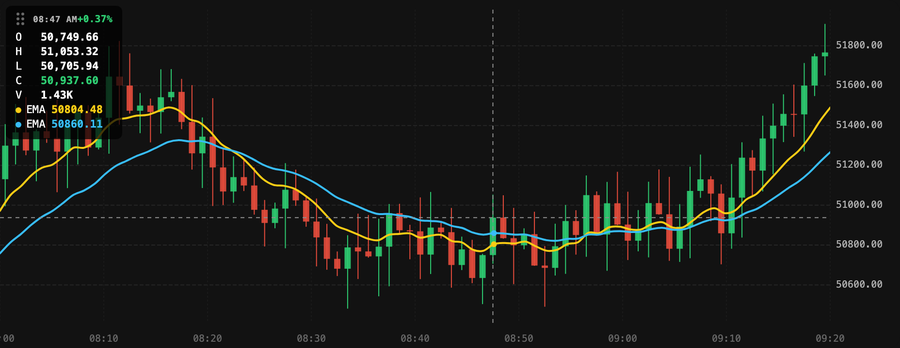

# React and Next.js (`@stacklatte/chart-react`)

HTML5 Canvas 2D — no WebAssembly, no `react-native-web`. Peers: `react` and `react-dom` 19+.

<!-- screenshots -->


<sub>`SLChart` with two EMA overlays, `showOhlcHud` (the crosshair + OHLC/indicator readout follows the pointer). Screenshot of the React demo, scenario `hud`. More: <a href="images/react-panels.png">RSI + MACD + Volume panels</a>, <a href="images/react-markers.png">trade markers</a>, <a href="images/react-light-theme.png">light theme</a>.</sub>
<!-- /screenshots -->


```sh
npm install @stacklatte/chart-react
```

## Minimal chart

```tsx
import { SLChart } from '@stacklatte/chart-react';
import type { Candle } from '@stacklatte/chart-react';

export function PriceChart({ candles }: { candles: Candle[] }) {
  return <SLChart data={candles} width={800} height={420} theme="dark" />;
}
```

A `Candle` is `{ timestamp, open, high, low, close, volume? }` with `timestamp` in **Unix milliseconds**. The array may be unsorted or contain duplicates and bad values — the chart sorts, dedupes and drops undrawable candles for you.

## Indicators, panels and markers

```tsx
import { SLChart, calcBollingerBands, calcEMA } from '@stacklatte/chart-react';
import type { Candle, ChartMarker } from '@stacklatte/chart-react';

export function Analysis({ candles, markers }: { candles: Candle[]; markers: ChartMarker[] }) {
  const ema = calcEMA(candles, 21, 'ema21', '#38bdf8');
  const bb = calcBollingerBands(candles, 20, 2, { upper: '#9ca3af', lower: '#9ca3af', basis: '#c084fc' });
  const indicators = [ema, bb?.upper, bb?.lower, bb?.basis].filter((l) => l != null);

  return (
    <SLChart
      data={candles}
      width={900}
      height={560}
      indicators={indicators}
      shadedAreas={bb ? [{ fromId: bb.upper.id, toId: bb.lower.id, color: '#c084fc', opacity: 0.12 }] : []}
      markers={markers}
      showVolumePanel
      showRsiPanel
      showMacdPanel
      showOhlcHud
    />
  );
}
```

`calcEMA`, `calcSMA` and `calcBollingerBands` return `null` when there are fewer candles than the period, so filter before passing them as `indicators`.

## Responsive width

`width` and `height` are numbers in CSS pixels (not `"100%"`). Measure the container:

```tsx
import { SLChart } from '@stacklatte/chart-react';
import type { Candle } from '@stacklatte/chart-react';
import { useEffect, useRef, useState } from 'react';

export function ResponsiveChart({ candles }: { candles: Candle[] }) {
  const ref = useRef<HTMLDivElement>(null);
  const [width, setWidth] = useState(0);
  useEffect(() => {
    const observer = new ResizeObserver(([entry]) => setWidth(Math.floor(entry.contentRect.width)));
    if (ref.current) observer.observe(ref.current);
    return () => observer.disconnect();
  }, []);
  return <div ref={ref}>{width > 0 && <SLChart data={candles} width={width} height={420} />}</div>;
}
```

## Next.js (App Router)

The chart draws on a `<canvas>` after mount, so it renders an empty frame on the server and paints in the browser. Mark the component that renders it as a client component:

```tsx
'use client';

import { SLChart } from '@stacklatte/chart-react';
import type { Candle } from '@stacklatte/chart-react';

export default function Chart({ candles }: { candles: Candle[] }) {
  return <SLChart data={candles} width={800} height={420} />;
}
```

## Interaction

Drag to pan, mouse wheel or two-finger pinch to zoom, hover (mouse) or touch to inspect a candle when `showOhlcHud` is on. `onCrosshairChange(candle | null)` reports the inspected candle. Increment `scrollToLatestTrigger` to jump back to the newest candle.

See also: [live data](./live-data.md), [performance](./performance.md), [API reference](./api-reference.md).

## Area charts and sparklines (lists of small charts)

`chartType="area"` is the close-price line with a gradient fill underneath, in the theme's `lineChart` colour. `sparkline` is the compact mode for many small charts at once (stock lists, table cells): no axes, grid, price gutter, panels, crosshair or tooltip, the whole dataset is drawn, and the chart **does not capture touch, wheel or pointer events**, so a long list still scrolls. For static data, `closesToCandles(prices)` turns a plain array of closing prices into chart data.

```tsx
import { useMemo } from 'react';
import { SLChart, closesToCandles, getThemeColors } from '@stacklatte/chart-react';

// A cool blue area on a transparent background.
const theme = { ...getThemeColors('dark'), background: 'transparent', lineChart: '#38bdf8' };

export function StockSparkline({ closes }: { closes: number[] }) {
  const candles = useMemo(() => closesToCandles(closes), [closes]);
  return <SLChart data={candles} width={120} height={40} sparkline theme={theme} />;
}
```

The same props work in Angular (`<sl-chart sparkline [theme]="theme" …>`) and React Native. See it with 24 stocks at [stacklatte.com/lab](https://stacklatte.com/lab) (the **Stock list** tab, which also has a copy button for the code and an AI prompt).
